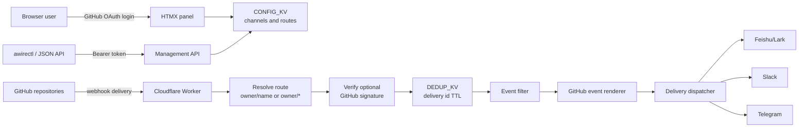

# awire

> Route GitHub events to Feishu/Lark, Slack, or Telegram from one Cloudflare Worker.

[](https://github.com/samzong/awire/actions/workflows/ci.yml)
[](https://github.com/samzong/awire/blob/main/LICENSE)

awire receives GitHub webhooks, filters them by repository and event action,
renders chat-friendly cards, and forwards them to your delivery channel.

Use it in two ways:

- **Hosted demo:** [https://awire.samzong.workers.dev](https://awire.samzong.workers.dev)
- **Self-hosted:** deploy the same Worker to your own Cloudflare account

## Hosted demo

The hosted demo is free to use:

1. Open [https://awire.samzong.workers.dev](https://awire.samzong.workers.dev).
2. Sign in with GitHub.
3. Add a delivery channel.
4. Add a GitHub repository or account-wide route.
5. Copy the GitHub webhook Payload URL shown in the panel.
6. Add that URL to GitHub repository webhooks.

The demo uses GitHub OAuth with `read:user` scope and stores each workspace
under the GitHub account id. Channel credentials and optional GitHub webhook
secrets are stored in the hosted Worker's Cloudflare KV. If those secrets must
stay inside your own infrastructure, self-host awire instead.

## What awire supports today

### Sources

| Source | Status | Notes |
|---|---:|---|
| GitHub webhooks | Supported | Repository webhooks posting to `/hook/github` or `/hook/github/<account>` |

### Delivery channels

| Channel | Status | Configuration |
|---|---:|---|
| Feishu/Lark custom bot | Supported | Webhook URL, optional signing secret |
| Slack incoming webhook | Supported | Webhook URL |
| Telegram bot | Supported | Bot token and `chat_id` |

### Routing and filtering

- Route one repository with `owner/name`.
- Route all repositories under an owner with `owner/*`.
- Forward all events, a whole event family such as `pull_request`, or one
  action such as `pull_request.opened`.
- Deduplicate GitHub delivery retries for 10 minutes.
- Manage config from the web panel, JSON API, or generated `awirectl` CLI.

Account-wide routing is an awire route shortcut, not GitHub webhook
installation automation. GitHub still has to send the webhook delivery to
awire for each repository you want forwarded.

## Architecture



Runtime shape:

- One Cloudflare Worker handles the webhook path, panel, and JSON API.
- `CONFIG_KV` stores channels and repository routes.
- `DEDUP_KV` stores short-lived delivery ids.
- GitHub OAuth protects the browser panel.
- `PANEL_TOKEN` protects the JSON management API.
- The renderer creates one internal card shape, then converts it for Feishu,
  Slack, or Telegram.

## GitHub event coverage

awire has specialized cards for the common repository events:

| Area | Events |
|---|---|
| Pull requests | `pull_request`, `pull_request_review`, `pull_request_review_comment` |
| Issues and comments | `issues`, `issue_comment` |
| Code and releases | `push`, `release` |
| CI and deploys | `workflow_run`, `check_run`, `deployment_status` |
| Repository activity | `star`, `fork`, `watch`, `ping` |
| Everything else | Generic card with event, action, sender, and linked object when available |

Some noisy actions are intentionally dropped by renderers even if GitHub sends
them and the route allows them.

## Self-host on Cloudflare

Self-hosting needs:

- A Cloudflare account with Workers and KV.
- A GitHub OAuth App for panel login.
- `PANEL_TOKEN`, `SESSION_SECRET`, `GITHUB_CLIENT_ID`, and
  `GITHUB_CLIENT_SECRET` set as Worker secrets.
- Two KV bindings: `CONFIG_KV` and `DEDUP_KV`.
- One delivery target: Feishu/Lark, Slack, or Telegram.

Use [docs/cloudflare-deploy.md](docs/cloudflare-deploy.md) for the complete
Cloudflare deploy runbook, including Deploy to Cloudflare, manual Wrangler
deploy, OAuth callback setup, KV namespace IDs, dry-run, and troubleshooting.

## Configure GitHub webhooks

Add a repo route in awire first. The panel shows the exact GitHub webhook
Payload URL for the current workspace. Use that URL in GitHub, set content
type to `application/json`, and subscribe to the events awire should receive.

For detailed webhook setup and troubleshooting, see
[docs/cloudflare-deploy.md](docs/cloudflare-deploy.md#runtime-setup).

## Local development

```bash
cp .dev.vars.example .dev.vars
pnpm dev
```

Fill `.dev.vars` with local GitHub OAuth credentials and generated secrets.
Open `http://localhost:8787`.

Useful checks:

```bash
pnpm typecheck
pnpm check:openapi
pnpm test:api
pnpm test:webhook
pnpm test:delivery
```

Card smoke tests:

```bash
SLACK_DRY_RUN=1 pnpm test:slack
TG_DRY_RUN=1 pnpm test:telegram
```

## JSON API and CLI

The browser panel is the normal path. The JSON API is available under
`/api/v1/*` and uses `Authorization: Bearer <PANEL_TOKEN>`.

Install the generated CLI locally:

```bash
pnpm install:cli
```

Point it at a deployment with `--hostname` or `AWIRE_HOST`.

## Limits

- GitHub is the only event source today.
- One route forwards to one channel.
- Events are not persisted; awire is a relay, not an audit log.
- KV is eventually consistent, so config changes can take up to about a minute
  to reach every Cloudflare edge.
- High-volume Feishu/Lark bots can still hit provider rate limits.

## Contributing

Read [CONTRIBUTING.md](CONTRIBUTING.md) before opening a PR. For security
reports, follow [SECURITY.md](SECURITY.md) and do not open a public issue.

## License

MIT. See [LICENSE](LICENSE).
